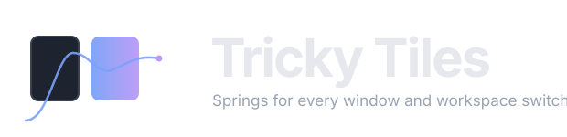
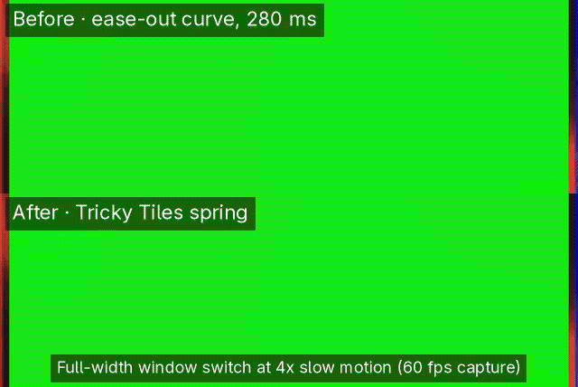
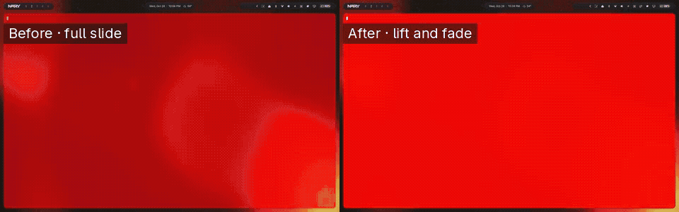
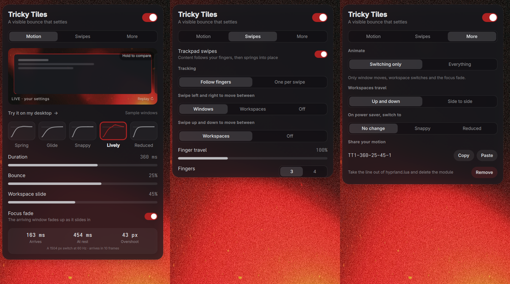

<div align="center">



<p><strong>Spring physics for switching windows and workspaces on Omarchy.</strong><br>
Moves start from rest, keep their momentum when you interrupt them, and settle, instead of jumping most of the way in the first frame.</p>

<p>
<a href="https://omarchyplugins.com/"></a>


<a href="LICENSE"></a>
</p>


</div>

<br>

<table align="center">
<tr>
<td align="center" width="33%"><h3>Pick a motion</h3>Five presets drawn as their own curves: Spring, Glide, Snappy, Lively and Reduced. Tune duration, bounce and workspace slide with three sliders.</td>
<td align="center" width="33%"><h3>See it first</h3>A live preview runs the exact spring Hyprland uses, with stills of your own windows. Hold <em>Compare</em> for stock Omarchy, or try one real step on your desktop.</td>
<td align="center" width="33%"><h3>Swipe along</h3>Three-finger swipes that follow your fingers, then let the spring finish from where you let go. Or one window or workspace per swipe, with wrap-around.</td>
</tr>
</table>

<br>

<div align="center">

</div>

## Why it feels different

<table>
<tr>
<td width="50%" valign="top"><strong>Momentum, not a jump.</strong><br>With a front-loaded ease-out, the first frame of a full-width switch on a 60 Hz panel covered 50–70% of the distance. With the Spring preset it covers 26–51%, and when the first frame is on time the move starts 1% → 8% → 18% → 30%. Two quick switches glide as one move instead of hitching.</td>
<td width="50%" valign="top"><strong>Hyprland's own springs.</strong><br>Hyprland 0.56 ships native, closed-form spring curves that keep their velocity when retargeted. Tricky Tiles exposes them as duration and bounce, like SwiftUI, and drives window moves, workspace switches and the special workspace (scratchpad, and the Quake console on Omarchy 4.5) with them.</td>
</tr>
<tr>
<td width="50%" valign="top"><strong>Swipes that track 1:1.</strong><br><em>Follow fingers</em> uses Hyprland's own trackers (the scrolling layout's window strip, and workspaces), the only way to get true tracking from Lua. Three or four fingers, adjustable finger travel, and your existing swipes are never overridden.</td>
<td width="50%" valign="top"><strong>Measured, not eyeballed.</strong><br>Every preset was recorded at 60 fps on a real compositor, an edge tracked frame by frame and fitted to the spring model. The recorded moves match the curve the panel shows to within about 1% RMS.</td>
</tr>
</table>

<div align="center">

<br><br>

</div>

## Everything in the panel

- **Master switch**: turn Tricky Tiles off to restore your config's own motion and swipes without uninstalling. Your settings are remembered; editing them while off keeps the plugin off until you turn it back on.
- **Presets, drawn as their curves**: Spring (default), Glide (no overshoot), Snappy, Lively (a visible bounce that settles) and Reduced (least motion).
- **Sliders**: duration, bounce, and workspace slide (full slide, a short lift with a fade, or a plain crossfade). A focus fade eases the arriving window up to its focused opacity.
- **A live preview** with stills of your own windows. Hold *Compare* to see stock Omarchy, or press *Try it on my desktop* for one real window step and workspace hop.
- **Trackpad swipes**: pick a setup (*Windows and workspaces*, *Workspaces side to side* or *Workspaces up and down*); the one that fits your layout is marked, and *Customise each direction* sets left/right and up/down separately. Then a feel: *Follow fingers* or *One per swipe* (with optional wrap-around on the window strip). Three or four fingers, adjustable finger travel.
- **Everything mode** (optional): opening, closing, menus and fades share the same duration.
- **Power saver**: switch to Snappy or Reduced while the power-saver profile is on.
- **Share codes** such as `TT1-290-15-30-1` to copy a motion to another machine.
- **The numbers for your screen**: when a full-width switch arrives, when it is at rest, and how far it overshoots, at your monitor's width and refresh rate.
- **Works from the keyboard**: Up/Down move between rows, Left/Right change the focused value, Enter or Space activates it, and `1`/`2`/`3` (or `[`/`]`) switch tabs.

<div align="center">

<br><br>

</div>

## Install

```bash
omarchy plugin add https://github.com/denonmaryland/omarchy-tricky-tiles --enable
```

Click the ◫ icon in the bar and press **Allow**. Requirements: **Omarchy 4.0.x or 4.5** with the Lua Hyprland config and **Hyprland 0.56 or newer** (native spring curves), Python 3, and `wl-clipboard` for share codes (already part of Omarchy).

On Omarchy 4.5:

- **Per-monitor workspaces.** Each monitor owns its own block of workspaces (1–10, 11–20, …). *One per swipe* stays inside the focused monitor's block and stops at its first and last workspace. *Follow fingers* uses Hyprland's tracker with its default `m` targets (the workspaces on this monitor) instead of `r`; when you swipe past the last one, Hyprland itself may still create the next numbered workspace.
- **Animations off.** If Hyprland's animations are off (`omarchy toggle animations`), the panel says so; your settings are kept and apply again once animations are back on.
- **Default layout.** The suggested swipe setup follows the layout from `omarchy hyprland workspace layout default`.

<details>
<summary><strong>What it changes on your system</strong></summary>
<br>

Nothing, until you press **Allow** in the panel. Then:

1. `tricky-tiles.lua` is written next to your `hyprland.lua` (the generated module), in `$XDG_CONFIG_HOME/hypr/` or `~/.config/hypr/`, wherever Hyprland reads its config.
2. One marked line is appended to `hyprland.lua`, in the file's own line-ending style; an exact timestamped backup `hyprland.lua.bak.<time>-tricky-tiles` is kept next to it:

   ```lua
   do local d = debug.getinfo(1, "S").source:match("^@(.*/)") or os.getenv("HOME") .. "/.config/hypr/"; local p = d .. "tricky-tiles.lua"; local f = io.open(p); if f then f:close(); dofile(p) end end -- Tricky Tiles (remove via its panel)
   ```

3. Settings are kept in `~/.config/omarchy/tricky-tiles.json`; a lock file, the power-saver flag and `last-load.json` (which swipes Hyprland turned down at the last load) live in `~/.local/state/tricky-tiles/`.

No other byte of your config is edited; Remove takes out exactly what was added. It needs no administrator rights, services, downloads or binaries. Motion changes apply instantly with `hyprctl eval`; swipe changes reload Hyprland. Every change is checked: each version of the module sets a fresh marker curve, and Tricky Tiles reads it back from `hyprctl animations` to confirm Hyprland runs that version. Errors that are not about Tricky Tiles (its module or its line in `hyprland.lua`) never block a change.

**Swipes you already define are left alone.** Hyprland refuses a swipe that an earlier one with the same finger count already covers, and reports it as a config error. Tricky Tiles reads those errors after the reload, leaves the refused directions to you, and reloads once more so no error remains (Hyprland's error bar may show for a moment). The same goes for a swipe of yours that loads after Tricky Tiles and would be refused because of it. Directions you free later are taken at your next swipe change. The Swipes tab also lists the swipes it finds in your files, with file and line, and offers the other finger count when it is free; that list is a best-effort reading of your files, while what Tricky Tiles registers comes only from Hyprland's answer.

**Dotfile managers are safe.** If `hyprland.lua` is a symlink (stow, chezmoi), Tricky Tiles writes through it, so the link stays a link. If Hyprland rejects a change, or the module does not load, the previous files come back and your saved settings are left as they were.

The frosted popup is used only alongside the separate `denon.bar` plugin; everyone else gets Omarchy's stock popup.

</details>

<details>
<summary><strong>Remove</strong></summary>
<br>

1. Open the panel, **More → Remove**. Hyprland first reloads with an empty stand-in module, to confirm that nothing of Tricky Tiles runs any more; then the line comes out of `hyprland.lua` and the module is deleted. Your previous motion and swipes return. If that reload fails, nothing is removed.
2. `omarchy plugin remove io.github.denonmaryland.tricky-tiles`
3. Optionally delete `~/.config/omarchy/tricky-tiles.json` and `~/.local/state/tricky-tiles/`.

If you remove the plugin first, the module keeps working (it lives in `~/.config/hypr`). Delete the marked line and `~/.config/hypr/tricky-tiles.lua` by hand, then `hyprctl reload`.

</details>

<details>
<summary><strong>How it works</strong></summary>
<br>

Hyprland 0.56 ships native, closed-form spring curves that carry their velocity when an animation is retargeted. Tricky Tiles exposes them as duration and bounce, like SwiftUI:

```
stiffness = (2π / duration)²        mass = 1
damping   = 4π (1 − bounce) / duration     →  damping ratio = 1 − bounce
```

The springs drive `windowsMove` (window strip steps, swipes, keyboard focus, width toggles), `workspaces` and `specialWorkspace`, including its `specialWorkspaceIn`/`specialWorkspaceOut` children, which Omarchy 4.5 sets for its Quake console and which would otherwise override the parent. With Tricky Tiles on, the console opens and closes with the spring and the slide style, not Omarchy's own drop-down/retract curves. The focus fade (`fadeSwitch`) is a state change, so it eases instead. *Follow fingers* uses Hyprland's own trackers (`scroll_move` for the window strip of the scrolling layout, `workspace` for workspaces). Lua cannot move the strip smoothly frame by frame, so this is the only way to get true 1:1 tracking. *One per swipe* runs a small Lua function when the fingers lift.

Design rules come from the motion checks on [userinterface.wiki](https://www.userinterface.wiki) ([skills](https://github.com/raphaelsalaja/skills)): springs for gestures and interruptible moves (`spring-for-gestures`, `spring-for-interruptible`), easing for state changes, small overshoot (`physics-subtle-deformation`), one focal point (the arriving window), and moves that arrive well under 300 ms.

Swipes were tested with a virtual multi-touch touchpad (drag, flick, short nudge, long drag; vertical workspaces; one-per-swipe with wrap-around). A note on recordings: in screen recordings the first frame of a switch that changes focus can appear 40–60 ms after the move starts. That delay comes from the recorder; on the real screen the switch starts at once.

</details>

<details>
<summary><strong>Development</strong></summary>
<br>

```bash
python3 -m unittest discover -s tests   # helper, rendered Lua module (with a stub hl API), install/remove
node --test tests/*.cjs                 # the panel's spring maths
omarchy plugin validate .
```

`tools/` holds the measurement harness. See `tools/README.md`.

</details>

<br>

<div align="center">
<sub>MIT licensed · built on <a href="https://omarchy.org">Omarchy</a> and <a href="https://hypr.land">Hyprland</a> · made by <a href="https://github.com/denonmaryland">denonmaryland</a></sub>
</div>
